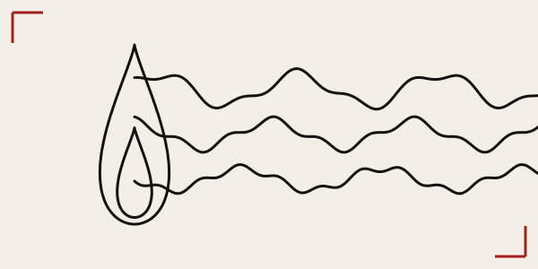

<div align="center">



<sub>the flame: <code>(1.1 sin(t) sin(t/2)^1.5, 2 cos(t))</code> and <code>(0.55 sin(t) sin(t/2)^1.5, cos(t) - 0.85)</code>, 0 ≤ t ≤ 2π<br/>the sea: <code>y = 0.35 sin(2x) + 0.12 sin(5x + 1) + 1</code>, <code>y = 0.3 sin(2x + 1.2) + 0.1 sin(6x)</code>, <code>y = 0.25 sin(2x + 2.5) + 0.08 sin(7x + 2) - 1</code>, -6 ≤ x ≤ 6</sub>

# nashkell

<sub>game theory, in Haskell, with Latin on top · <a href="https://h0ffmann.github.io/nashkell/">the site</a> · <a href="REFERENCES.md">references</a> · <a href="notes/index.md">notes</a> · <a href="AGENTS.md">for agents</a></sub>

[](https://doi.org/10.5281/zenodo.23356739)
[](https://doi.org/10.5281/zenodo.23356740)

[](https://github.com/h0ffmann/nashkell/actions/workflows/site.yml)
[](https://github.com/h0ffmann/nashkell/actions/workflows/md.yml)
[](https://github.com/h0ffmann/nashkell/actions/workflows/links.yml)
[](#project-layout)
[](LICENSE)

by [matheus hoffmann](https://h0ffmann.github.io/h0ffmann/) (h0ffmann). **the open book, in progress:** [*Nashkell: Rhizomatic experiments*](book/nashkell.pdf), in the voice of Nash, a persona of the author (not the mathematician John Nash). its text is CC BY 4.0. the website draws what this repository is, why open source reads as a game of two players, what the study of obfuscation with git and Latin found, and four drawings made of equations. where each fact was read: [`REFERENCES.md`](REFERENCES.md).

</div>

An algebraic-effects (Polysemy) pipeline that:

1. Runs OCR on a scanned document via Tesseract (invoked as an external process, not FFI).
2. Asks an LLM to sanity-check whether the OCR output looks technically corrupted.
3. Asks an LLM to write speculative, explicitly-marked-as-speculative annotations on cryptic passages.
4. Cross-references those annotations against real Game Theory / history-of-mathematics literature, distinguishing "no source found" from "contradicted" from "likely fabricated."

The project was built around a specific test case: the declassified 1955 correspondence between John Nash and the NSA (a real historical document, unrelated to the "chip implant" urban legend that inspired this whole detour).

All source comments are written in **Classical Latin**; identifiers, types, and prompt strings stay in English. This is a stylistic constraint enforced by a git hook (see below), not a technical requirement.

## Project layout

```text
nashkell.cabal
flake.nix
app/Main.hs                                -- entry point, wires the effect stack together
src/Nashkell/Effect/Ocr.hs                 -- the Ocr effect algebra
src/Nashkell/Interpreter/Tesseract.hs      -- interprets Ocr via the `tesseract` CLI
src/Nashkell/Retry.hs                      -- generic retry combinator over any Error effect
src/Nashkell/Llm/Effect.hs                 -- the LlmVerify effect algebra (3 operations)
src/Nashkell/Llm/Interpreter/Anthropic.hs  -- interprets LlmVerify via the Anthropic API
src/Nashkell/Pipeline.hs                   -- composes everything into one pipeline
.githooks/pre-commit                       -- rejects commits with non-Latin comments
.githooks/check-latin.sh                   -- the actual heuristic check
```

## Building

### With Nix (works on any Linux distro, NixOS not required)

```bash
nix develop
cabal build
```

### Without Nix

You need GHC (9.8.x recommended, matching `flake.nix`), Cabal, and the `tesseract` binary + English trained data available on your `PATH` / system package manager (e.g. `apt install tesseract-ocr tesseract-ocr-eng` on Debian/Ubuntu).

```bash
cabal build
```

## Running

```bash
export ANTHROPIC_API_KEY=sk-ant-...
cabal run nashkell -- /path/to/scanned-document.png
```

## Git hooks (Latin comment enforcement)

Hooks are versioned in `.githooks/` (not `.git/hooks/`, which is never committed). Enable them once per clone:

```bash
git config core.hooksPath .githooks
chmod +x .githooks/*
```

### Known limitation of the check

`check-latin.sh` is a regex heuristic, not a real Haskell parser -- it flags any line containing `--` and then greps for common English/Portuguese function words. This means it **cannot distinguish a real comment from a string literal that happens to contain a literal `--`**. Concretely, in this codebase it currently flags one line in `Anthropic.hs`:

```haskell
, "  illegible or nonsensical -- say so plainly if that is the case."
```

That's an English-language LLM prompt string (correctly in English, since it's sent to the API), not a comment -- a false positive by design of the heuristic. A correct fix would extract comments using the real GHC lexer (`ghc-lib-parser`), which knows the difference between a comment token and a string token. That's a reasonable follow-up if the false-positive rate ever becomes annoying in practice; for a project this size, the regex approach was judged proportional.

## Identifier obfuscation (optional)

There is also a git `clean`/`smudge` filter pair that lets you write
and read code with English identifiers locally, while what gets
committed to git -- and therefore what GitHub shows -- has type,
constructor, field, and function names translated to Latin. It is
independent of the comment-language hook above (that one enforces
Latin *prose in comments*; this one translates *identifiers*). See
[`README-latinizer.md`](./README-latinizer.md) for the full mechanism,
what was actually tested, and its known limitations -- most
importantly, that the Latin form stored in git is not directly
buildable, by design, since file paths are never renamed. Install with:

```bash
./setup-latinize.sh
```

## Design notes

- **Why shell out to `tesseract` instead of FFI bindings**: Tesseract is a C++ library with an unstable ABI across major versions, bundled with a second native dependency (Leptonica). Haskell FFI bindings to it tend to be thinly maintained. Invoking the CLI trades a small amount of process-spawn overhead for process isolation (a Tesseract crash doesn't take your Haskell process down with it) and zero binding-maintenance burden.
- **Why three separate LLM operations instead of one combined prompt**: OCR-quality assessment, speculative interpretation, and factual cross-referencing are three different kinds of judgment. Merging them into a single prompt tends to produce answers that look more confident than any individual judgment warrants -- separating them keeps each prompt adversarial toward the failure mode specific to that task (e.g. the cross-reference prompt is explicitly instructed to prefer "no source found" over inventing one).
- **Why `NoSourceFound /= LikelyFabricated`**: absence of evidence is not evidence of absence. Collapsing the two into one "unconfirmed" bucket would silently discard that distinction.
